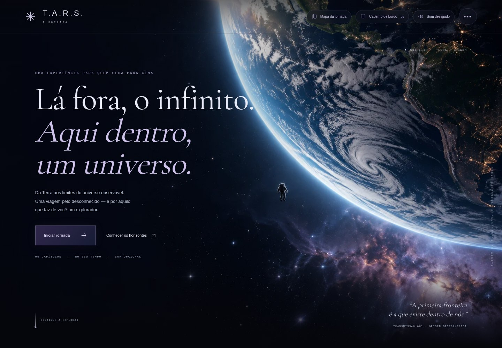
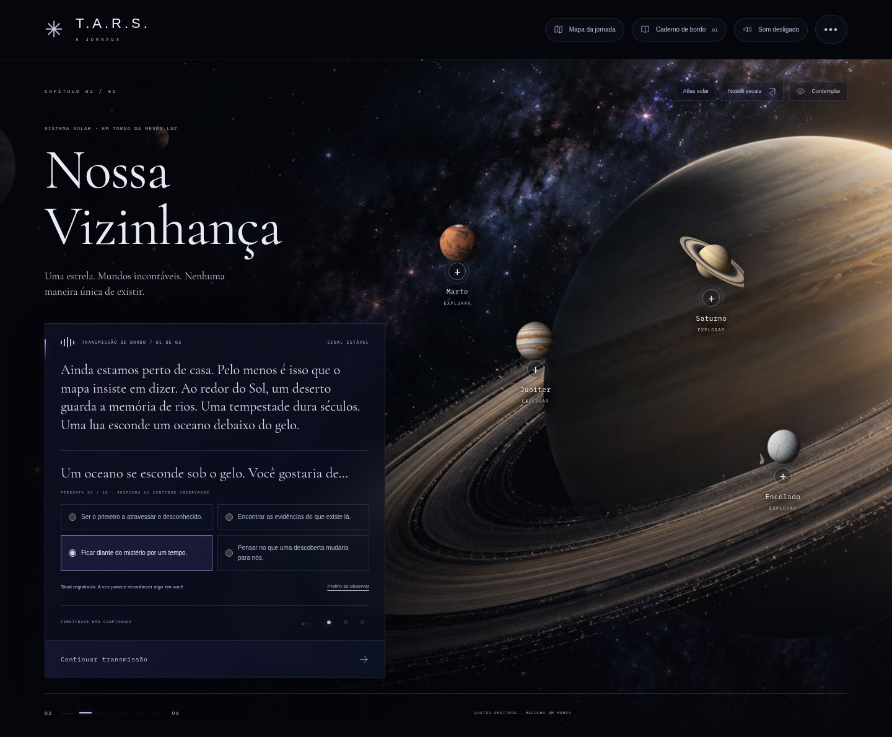
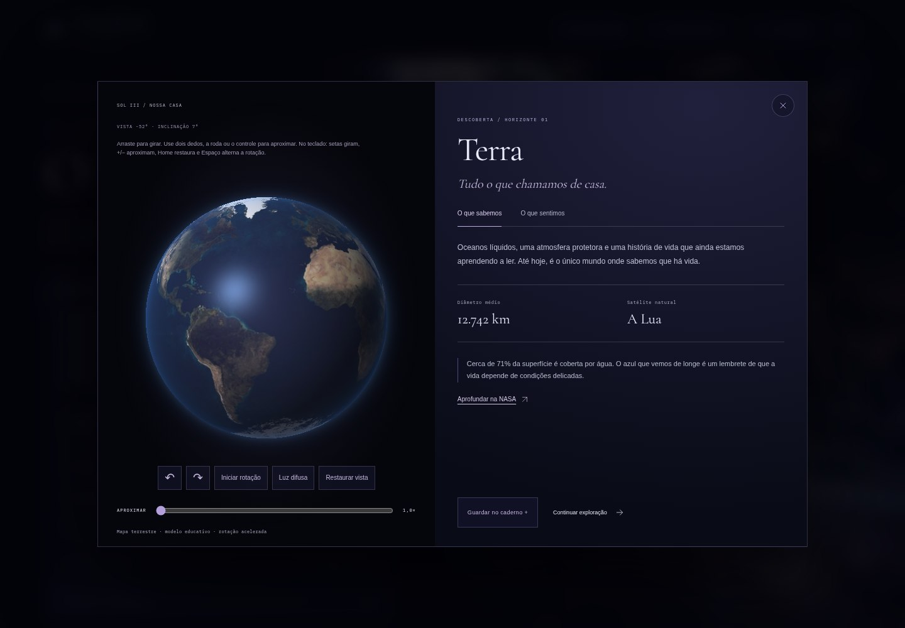

# T.A.R.S. — A Jornada

Uma experiência narrativa e contemplativa da Terra aos limites do universo observável. Seis horizontes, uma voz de origem desconhecida e escolhas que deixam um retrato da sua própria maneira de explorar.



## Rodar agora

Extraia a pasta e abra **`index.html`** no navegador. Os arquivos precisam permanecer juntos. Não é necessário instalar pacotes, conectar à internet ou executar um build.

Com Node.js, também é possível usar o servidor estático opcional:

```sh
node tools/serve.mjs
```

Abra a porta 8080 no navegador local. Para outra porta, configure `PORT` antes de executar. O servidor é uma ferramenta de desenvolvimento; a aplicação não tem backend.

## O que mudou nesta versão

- O avanço de transmissão e de capítulo agora fica **dentro do painel da voz**, com uma faixa em lavanda e azul profundo. Os controles superiores seguem a mesma linguagem visual.
- **Dez perguntas opcionais**, espalhadas pelos seis capítulos, registram escolhas e produzem um encerramento pessoal. É possível pular, revisitar e editar respostas.
- **Retratos de exploração:** explorador de horizontes, cartógrafo do invisível, observador do silêncio ou tecelão de encontros. Preferências próximas geram um retrato misto; poucas respostas deixam o horizonte em aberto.
- **Globos interativos:** arraste para girar, use dois dedos/roda/slider para aproximar, pause a rotação e restaure a vista. Terra, Lua, Marte, Júpiter, Saturno, Encélado, Vênus e Netuno têm mapas locais; Mercúrio e Urano têm superfícies procedurais identificadas.
- **Atlas dos oito planetas**, acessível em Nossa Vizinhança. Os quatro objetos da cena continuam disponíveis sem sobrecarregar a composição.
- **Galáxias e teia em profundidade**, com rotação, zoom, braços/filamentos e estrutura visual manipulável. Estrelas, disco de acreção e horizonte também têm controles.
- **Trilha musical original:** Entre horizontes, 96 segundos de piano sintetizado, camadas harmônicas e pulsação suave, em **CC0 1.0 Universal**.
- As transmissões deixam mais pistas sobre a origem do sinal, preservando a revelação final.



## Percorrer a experiência

A abertura tem três atos e pode ser pulada. Cada capítulo tem três transmissões, avançadas voluntariamente. O mapa permite revisitar somente os destinos alcançados.

As 13 descobertas da narrativa permanecem, e o atlas acrescenta Mercúrio, Vênus, Urano e Netuno: **17 objetos exploráveis**. Os painéis separam **O que sabemos** e **O que sentimos**, com fatos, curiosidades, fontes e reflexão.

No caderno, você pode guardar descobertas, rever as perguntas já encontradas e exportar os registros. O encerramento inclui seu retrato, exemplos das escolhas que o originaram e uma carta que você pode baixar. A sua palavra final pode acompanhar essa carta.

Também há escala de distâncias, lente temporal de Andrômeda, modo de contemplação, movimento reduzido, volume e tela cheia quando o navegador oferecer suporte.

## Perguntas e retratos

As dez perguntas estão em `js/profiles.js`: duas em cada um dos primeiros quatro capítulos e uma em cada um dos dois últimos. As respostas são opcionais; avançar sem escolher registra a pergunta como deixada em aberto.

Cada alternativa aproxima dois modos de exploração: **2 pontos para a afinidade principal e 1 para a secundária**. O resultado usa as escolhas registradas, sem inferir dados pelo comportamento de navegação. Com menos de três respostas, ele não atribui um retrato individual. Quando os dois modos mais presentes ficam próximos, o texto preserva essa mistura.

Este é um **recurso narrativo de autorreflexão**, não um instrumento psicológico validado nem um diagnóstico de personalidade. O resultado descreve preferências expressas nesta viagem, cita respostas reais e pode mudar quando elas são editadas. Não promete descobrir uma personalidade definitiva com dez perguntas.

Progresso, respostas e caderno ficam em **sessionStorage**, apenas nesta aba. Recarregar permite retomar; fechar a aba normalmente encerra a sessão. Reiniciar limpa a jornada. A palavra da carta permanece em memória até sair/recarregar. Se o navegador bloquear o armazenamento, a exploração continua em memória. Nenhuma resposta é enviada a servidores ou APIs.

## Exploração visual

O renderizador em `js/explorer.js` usa **WebGL nativo**, sem motor externo: projeção de esferas texturizadas, anéis e nuvens de pontos tridimensionais. Há uma alternativa em Canvas2D caso WebGL não esteja disponível.

- **Mouse/toque:** arraste para orbitar; dois dedos ou a roda aproximam.
- **Teclado:** setas giram; `+`/`−` aproximam; `Home` restaura; `Espaço` alterna a rotação.
- **Controles visíveis:** girar, iniciar/pausar, iluminação/estrutura e restaurar.
- **Vênus:** alterna nuvens ilustrativas e mapa de superfície por radar.
- **Galáxias:** o botão destaca os braços. **Teia:** realça ou recolhe o traçado dos filamentos.

As texturas são incorporadas em `assets/textures/maps.js` para permitir uso direto por `file://`, sem depender de CORS ou de serviços externos. A procedência e as licenças estão em `assets/textures/SOURCES.md`.

A rotação é educativa e acelerada. Não há simulação de órbitas, relatividade ou evolução real do cosmos. Superfícies procedurais não representam mapas exatos; cores e iluminação são aproximadas. Mapas históricos da NASA podem ter cores processadas. Galáxias, teia, estrelas e horizonte são representações artísticas. O universo observável não possui uma borda física demonstrada.

Com movimento reduzido, os objetos começam parados. O visitante pode iniciar a rotação explicitamente. O renderizador é encerrado ao fechar o painel e suspende atividade em abas ocultas.



## Trilha musical

**Entre horizontes** é uma composição/gravação original sintetizada para esta obra. Não utiliza samples, gravações, temas ou melodias de filmes. Piano, sustentação harmônica, ecos e pulsação criam uma atmosfera contemplativa com desenho musical próprio.

O MP3 está incluído em `assets/audio`. É disponibilizado junto ao gerador sob **CC0 1.0 Universal**, conforme `assets/audio/CC0.md`; não é necessário pagar royalties desta gravação para utilizá-la no projeto. As fontes e imagens mantêm suas respectivas licenças.

Sem autoplay: o áudio começa exclusivamente pelo botão, com volume inicial moderado. Há pausa, retomada e loop; ocultar a aba interrompe a reprodução. Para substituir a música, altere `AUDIO_FILE` em `script.js` e registre a licença. O processo de síntese pode ser reproduzido com Node.js e FFmpeg, mas essas ferramentas não são necessárias para usar o arquivo pronto.

## Estrutura e edição

```text
index.html                 Estrutura, HUD e dialogs acessíveis
style.css                  Direção de arte base e capítulos
css/experience.css         Transmissão, escolhas, retratos e visualizador
script.js                  Navegação, estado, controles e áudio
js/data.js                 Ciência, narrativa e atlas
js/profiles.js             Dez perguntas, pesos e textos de encerramento
js/explorer.js             WebGL e alternativa Canvas2D
assets/images/             Cenários WebP e favicon
assets/textures/            Mapas incorporados, fontes e licença MIT
assets/fonts/              Fontes locais e licenças OFL
assets/audio/              Trilha original, documentação e CC0
docs/                      Prévias da interface
tools/serve.mjs             Servidor estático opcional
tools/compose-audio.mjs     Gerador original da trilha
tests/                     Verificações de navegador e de perfis
BRIEFING_TARS_V1.md         Briefing original
```

**Textos e descobertas:** edite `chapters`, `objects` e `objectDetails` em `js/data.js`. Perguntas e retratos estão em `js/profiles.js`. O posicionamento dos marcadores está em `chapters.positions`.

**Imagens:** a abertura usa `arrival.webp`; os capítulos referenciam os outros cenários pelo campo `image`. Prefira WebP/AVIF de 1600–1920 px, com objetos à direita e espaço escuro à esquerda para texto. Confira a licença ao substituir qualquer material. O atlas ilustrativo `planets.webp` ainda compõe os marcadores da cena solar; o visualizador usa os mapas separados.

**Modelos:** cores, modos e mapas ficam em `specs` no renderizador. O conteúdo científico deve permanecer distinguível da representação artística.

**Som:** o arquivo pronto é `assets/audio/entre-horizontes.mp3`. O campo `AUDIO_FILE` seleciona a faixa; uma string vazia permite a antiga ambientação sintetizada como alternativa.

## Publicar

**GitHub Pages:** em Settings → Pages, escolha Deploy from a branch, `main` e `/ (root)`. Os caminhos relativos também funcionam em `/T.A.R.S/`. Não há build ou configuração de SPA.

**Netlify:** envie a pasta pelo deploy manual, ou conecte o repositório com diretório de publicação `.` e nenhum comando de build.

Enviar os arquivos ao GitHub não ativa automaticamente a publicação do site.

## Acessibilidade e desempenho

Controles nativos, foco visível, link de salto, dialogs com Escape e retorno de foco, abas por teclado e perguntas em grupos de radio buttons. A experiência é compreensível sem som. `prefers-reduced-motion` é respeitado, com preferência adicional na interface.

Cenários e fontes são locais; os mapas são carregados apenas ao explorar um objeto/abrir o atlas, e a música somente após comando. Animações dos modelos usam frames sob demanda, limitam resolução e ritmo, e encerram os recursos gráficos quando o painel fecha. O campo estelar de fundo é redesenhado somente ao carregar ou redimensionar.

## Verificar

A aplicação não precisa de dependências. O teste de retratos usa apenas Node.js:

```sh
node --test tests/profiles.test.cjs
```

Para os testes opcionais de navegador:

```sh
npm install --no-save --package-lock=false playwright
npx playwright install chromium
node tools/serve.mjs
# Em outro terminal:
node tests/e2e.cjs
node tests/experience.e2e.cjs
```

Use `CHROMIUM_PATH` para um Chromium já instalado e `TARS_BASE_URL` para outro servidor/porta. As capturas ficam em `test-results`, ignorado pelo Git.

As verificações cobrem jornada completa, mapas bloqueados, responsividade de 320 a 1440 px, foco, perguntas, resultados, revisão/retomada/exportação, planetas, interação 3D, alternativa sem WebGL, reprodução real do MP3 e ausência de autoplay. Fontes e créditos científicos/artísticos estão em `assets/CREDITS.md`.
